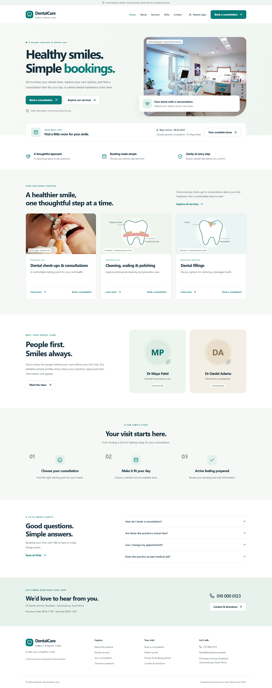
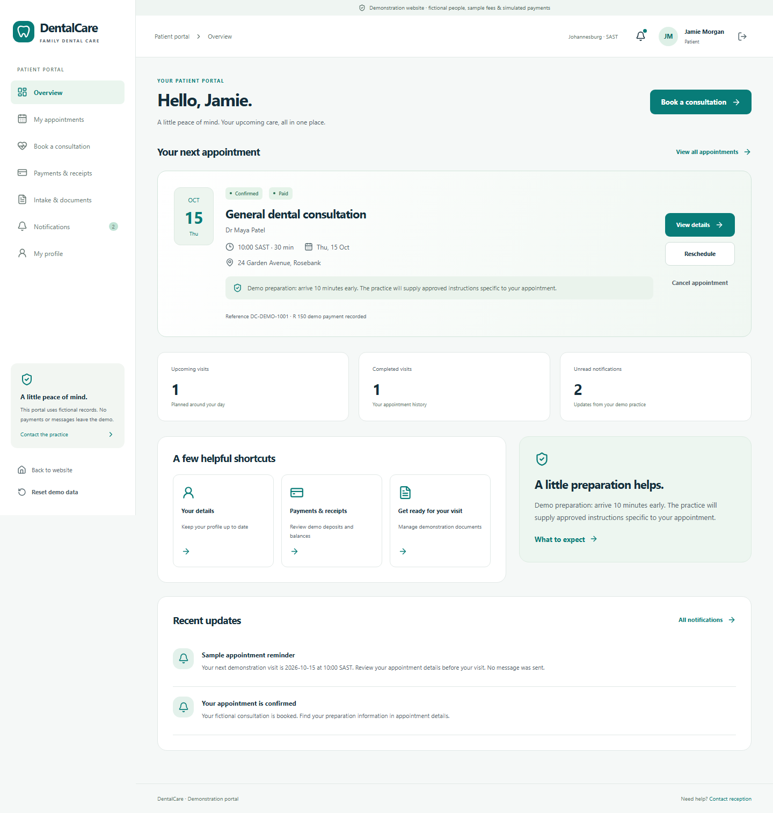
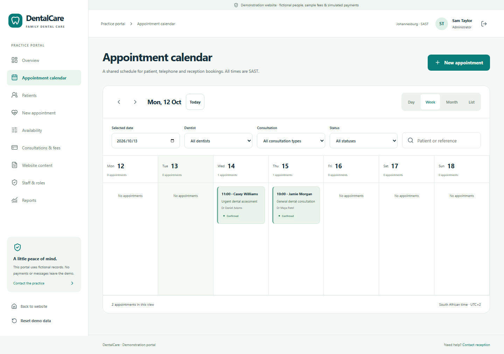
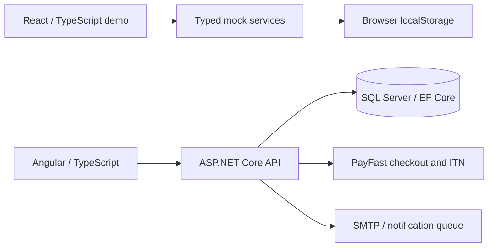

# Dental Practice Management & Patient Portal

A portfolio project for a dental practice: patients book and manage appointments, reception manages the calendar and payments, and administrators configure services, staff and availability.

The repository includes two applications. The **React demo** is the fastest way to explore the experience without a database. The **Angular + ASP.NET Core application** implements server authentication, SQL Server persistence, booking transactions and payment-provider integration.

## Preview



| Patient portal | Reception calendar |
| --- | --- |
|  |  |

Screenshots show fictional records. See the [React guide](frontend/dentalcare-react/README.md) for screen details and image attribution.

## Run the demo

Requires Node.js 22.12+ or 24 and npm. From the repository root:

```sh
cd frontend/dentalcare-react
npm ci
npm run dev -- --host 127.0.0.1 --port 5173
```

Open **http://127.0.0.1:5173**. On Windows, `start-react-demo.bat` also installs missing dependencies and starts the demo.

Use the role buttons on `/login`, or these accounts. All use `Demo123!`.

| Role | Email | Explore |
| --- | --- | --- |
| Patient | `patient@demo.local` | Booking, appointments, profile and receipts |
| Reception | `reception@demo.local` | Calendar, telephone bookings, payments and reports |
| Dentist | `dentist@demo.local` | Assigned appointments and schedule |
| Administrator | `admin@demo.local` | Services, fees, staff, availability and website content |

Suggested walkthrough: sign in as Patient, book a consultation, simulate a failed payment and retry successfully, then reschedule the appointment. Sign in as Reception to find that booking in the calendar. Sign in as Administrator to explore availability and service configuration. **Reset demo data** restores starter records.

The demo stores fictional data in browser localStorage. Authentication, payments, recovery requests and document metadata are simulated; it makes no backend requests. Role checks demonstrate the interface and are not a security boundary. Use fictional information only.

## Features and implementation

| Area | React demo | Angular + .NET application |
| --- | --- | --- |
| Public website | Services, team, FAQs, contact and policies | Services and editable practice information |
| Patient experience | Nine-stage booking, profile, appointments, receipts and metadata uploads | Registration, profile/photo uploads, booking, rescheduling, cancellation and receipts |
| Scheduling | Mock availability, breaks, leave and temporary holds | Server validation and serializable SQL booking transactions |
| Staff tools | Day/week/month/list calendar, patient lookup, manual booking and CSV reports | Staff schedule, patient lookup, status changes, reports and administration |
| Identity | Fictional accounts and browser persistence | ASP.NET Core Identity, JWT, recovery, verification and authenticator MFA |
| Payments | Simulated outcomes, payment records and refunds | Cash records, PayFast checkout/ITN validation, expiring holds and refund ledger |
| Notifications | Mock updates and preferences | SMTP integration, queued notifications and development inbox |

## Engineering highlights

- Booking rules account for working hours, appointment duration, dentist availability, leave and existing reservations.
- The API checks patient ownership and staff roles; JWT validation also checks user activation and the security stamp.
- PayFast confirmation uses validated server notifications; pending holds expire and the payment service handles duplicate notifications.
- Profile pictures use authenticated endpoints, size limits, file-signature validation and storage outside the public web root.
- React domain models and service adapters separate UI behavior from mock persistence.
- Automated tests exercise booking conflicts, payment retry/expiry, staff workflows, mobile layouts and selected accessibility checks.

## Architecture



The React demo is independent of the API. Setting `VITE_API_BASE_URL` alone does not connect it; replacing its service implementations is a future integration task.

```text
backend/DentalPractice.API/       ASP.NET Core controllers, services and EF models
frontend/dentalcare-react/        React demo, unit tests and browser tests
frontend/dental-practice-ui/      Angular application connected to the API
database/                       Bootstrap and SQL upgrade scripts
tests/portal_smoke.py            API checks using an isolated database
docs/                           Architecture, setup and verification guides
.github/workflows/ci.yml         Build, lint, unit and browser checks
```

## Run the full-stack application

Requires .NET 8 SDK (or a compatible newer SDK), Node.js 22.12+ or 24, npm and SQL Server. The default connection uses local SQL Server with Windows authentication.

From the repository root, install dependencies:

```sh
dotnet restore DentalPracticeSystem.sln
cd frontend/dental-practice-ui
npm ci
```

Start the API from the repository root in one terminal:

```sh
dotnet run --project backend/DentalPractice.API --launch-profile http
```

Start Angular in another terminal:

```sh
cd frontend/dental-practice-ui
npm start
```

| Service | Local URL |
| --- | --- |
| Angular | http://localhost:4200 |
| API | http://localhost:5144 |
| Swagger (Development) | http://localhost:5144/swagger |

Windows helpers: `setup-dev.bat` installs full-stack dependencies; `start-dev.bat` starts both applications.

Development seeds `admin@dental.local`, `dentist@dental.local` and `reception@dental.local`, each with `ChangeMe123!`. Register a patient through Angular. These are separate from the React accounts.

### Database and configuration

The default connection in `backend/DentalPractice.API/appsettings.json` is:

```text
Server=localhost;Database=DentalPracticeDb;Trusted_Connection=True;TrustServerCertificate=True;MultipleActiveResultSets=true
```

Override it with `ConnectionStrings__DefaultConnection` for a named instance or SQL authentication. Startup uses `EnsureCreatedAsync()` for a new schema; it does **not** migrate existing databases. Back up older databases and apply the relevant scripts in order: `upgrade-profile-v2.sql`, `upgrade-payments-v3.sql`, then `upgrade-portal-v4.sql`.

For optional Docker SQL Server, copy `.env.example` to `.env`, set your own `MSSQL_SA_PASSWORD`, then run `docker compose up -d`. Configure the API connection separately with that password. Docker's `.env` is not automatically loaded by ASP.NET Core; the Windows-authentication default cannot authenticate to the container.

PayFast and SMTP are disabled by default. Use environment variables or .NET user secrets for credentials. Committed PayFast Development values are sandbox examples. See [PayFast setup](docs/PAYFAST.md) and [SMTP, MFA and portal setup](docs/PORTAL_V4.md). Development email is stored privately under `App_Data/DevelopmentInbox`.

## Verification

React checks, from `frontend/dentalcare-react`:

```sh
npm run build
npm run lint
npm test
npx playwright install chromium
npm run test:e2e
```

Full-stack checks, from the repository root:

```sh
dotnet build DentalPracticeSystem.sln --configuration Release
dotnet build backend/DentalPractice.API
python tests/portal_smoke.py
```

The API smoke test requires Python, `sqlcmd`, local SQL Server and Windows authentication with permission to create/drop a test database. It creates and removes a uniquely named `DentalPortalSmoke_*` database and runs its API on port 5145. It does not use the practice database.

Build Angular from `frontend/dental-practice-ui` with `npm run build`. GitHub Actions runs both frontend builds, the API build and React automated checks. SQL integration checks run locally because they require SQL Server. See [verification results](docs/VERIFICATION.md) and the [manual test plan](docs/TESTING.md).

## Scope and remaining work

This is a portfolio and development project. The React demo supports fictional walkthroughs; the full-stack application needs deployment configuration and further review before live patient use.

- Clinical records, medical-aid claims, telehealth and automated provider refunds are outside the API's scope. React intake and document screens use fictional text and metadata only.
- The API uses schema creation and supplied SQL upgrades rather than an EF migration history.
- SMTP delivery uses one worker instance; scaling requires a distributed queue/claim mechanism.
- React recovery, uploads and payment flows remain mocks. Educational visuals and sample practice content need dental review.
- Deployment requires secrets, HTTPS, restricted database access, reviewed privacy/retention policies, monitoring and tested backups. See the [deployment checklist](docs/DEPLOYMENT_CHECKLIST.md).

## Documentation

- [React guide and image attribution](frontend/dentalcare-react/README.md)
- [API reference](docs/API.md)
- [Data model](docs/ERD.md) and [ERD image](docs/database-erd.png)
- [Security controls and boundaries](docs/SECURITY.md)
- [Payment integration](docs/PAYFAST.md)
- [Portal, SMTP and MFA setup](docs/PORTAL_V4.md)
- [Practice customization](docs/CLIENT_CUSTOMIZATION.md)
- [Verification report](docs/VERIFICATION.md)
