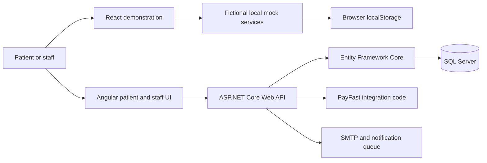

# Dental portfolio architecture and delivery boundaries

This repository contains **two distinct experiences**, not two clients or two production deployments.

## Business workflow

The specific Zimbabwean dental practice currently arranges consultations through in-person receptionist interactions. The proposed platform aims to allow patients to explore services, arrange consultations remotely, view revisit/booking information, and pay online with an appropriate provider. It also gives staff separate role-based calendar and practice tools.

## Truthful boundaries

- **React demo:** fictional accounts, locally simulated authentication, payments and booking interactions; not a security boundary and not connected to the API.
- **Angular + .NET:** implements connected backend/database workflows; security and payment functionality still require real-world deployment and end-to-end verification.
- **Payment:** integration with PayFast does not prove merchant eligibility, payout compatibility or settlement arrangements for a Zimbabwean practice.
- **Clinical privacy:** no real patient details in public screenshots or demos; the software is **not yet a deployed healthcare service**.
- **Verification:** my manual API testing used Swagger UI. Existing automated-test files and CI jobs are repository tooling, not personal automated-testing claims.

See [the main README](../README.md), [case study](CASE_STUDY.md) and [deployment checklist](DEPLOYMENT_CHECKLIST.md).
